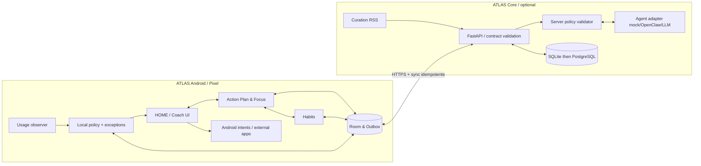

# 02 — Architecture technique de référence

> **Document de cible, pas inventaire de la V4 livrée.** Les composants Room/DataStore, modules Gradle `core-*`/`feature-*`, WorkManager, PostgreSQL, RSS et adaptateurs LLM/OpenClaw décrivent une évolution envisagée et ne sont pas présents dans la branche V4. La réalisation vérifiée est décrite dans [docs/v4/02-architecture-realisee.md](v4/02-architecture-realisee.md).

## Modules et responsabilités envisagés (cible non livrée)
- `android/app`: activité HOME facultative, Compose, navigation, onboarding, accessibilité UI, notifications.
- `android/core-domain`: modèle d'événements, actions, états de focus, politiques et évaluations **pur Kotlin**, testable hors Android.
- `android/core-data`: Room, DataStore, stockage des consentements, outbox, export.
- `android/feature-focus`: sessions 10/25 min, état persistant, règles locales et rappel.
- `android/feature-habits`: CRUD habitudes, check-ins, cadence, journal.
- `android/feature-usage`: `UsageStatsManager` opt-in, agrégation et détection non critique, fallback si permission refusée.
- `android/feature-content`: mini bibliothèque, intents vers URL / navigateur / lecteur choisi, pas de contrôle interne de ReVanced.
- `android/feature-coach`: protocole directive/négociation, fonctionnement déterministe local sans backend.
- `backend`: API et modèle de données, policy validation, scheduler unique, connexion au modèle via `AgentAdapter`, outils volontairement limités.
- `contracts`: schémas JSON versionnés et exemples, identiques côté serveur / Android lorsque possible.

## Source de vérité et hors ligne — exigences de cible
- Android est propriétaire de l'état des timers, consentements, règles activées localement, événements et check-ins. Le serveur reçoit des copies via événements idempotents.
- Serveur : projets, synthèses, curation et propositions IA. En cas de conflit, ne jamais écraser un consentement local par une décision serveur.
- L'application doit fonctionner sans serveur : fixture de directive claire, horodatée « démonstration locale », recommandations d'exemple et journal.
- Outbox `event_id` UUID, timestamps UTC, version de schéma, accusé de réception et reprises sans doublon. Sync via HTTPS lorsque configurée.
- Les nouvelles politiques passent par une demande de changement confirmée dans ATLAS Android ; la sauvegarde doit conserver la version consentie et les exceptions vitales.

## Interfaces d'agent — contrats envisagés, non connectés
- `AgentAdapter.propose(context, mandate, capabilities) -> ProposedDirective`, sans accès aux API Android ou au shell du téléphone.
- `PolicyEngine.validate(ProposedDirective, mandate, state) -> accepted/rejected + reason` ; le serveur et le client valident les effets locaux indépendamment.
- Curation via `ContentSource` : stub statique, puis RSS/Miniflux, autres sources autorisées ; aucune promesse d'accès au flux de recommandations privé YouTube.
- `HabitProvider` : `AtlasLocal` par défaut ; `LoopInterop` uniquement si lien documenté / testable ; ne pas importer le code GPL sans étude.
- `AppControlProvider` : `UsageStatsOnly` par défaut ; contrôles/accessibilité plus invasifs derrière un drapeau expérimental distinct et un consentement explicite.

## Authentification et confidentialité
- Backend en local dev : mode mock uniquement. Toute API réellement exposée exige authentification appareil et HTTPS via réseau privé (ex : Tailscale) ; ne pas ouvrir de serveur sans authentification sur Internet.
- Secret Android dans Keystore ; secrets serveur hors code et prompts ; permissions minimales ; limitation de fréquence.
- Export local JSON/CSV, suppression des données, panneau de consentement et désactivation de l'observation.
- Aucune collecte continue des contenus d'écran, notifications privées ou microphone.
- Protection contre les injections : contenus web/RSS = données non fiables ; aucun changement de mandat ou exécution système depuis des contenus externes.

## Contrat de « friction »
Une règle calcule localement `threshold_reached`, vérifie exceptions/cooldown/repos et produit `show_soft_intervention`. UsageStats fournit des événements **best effort** ; si Android ne permet pas d'interrompre l'app tierce au moment exact, utiliser notification ou interface ATLAS, sans fausse garantie.

## Déploiement et environnement envisagés
- Android : Kotlin, Compose, Room, DataStore, WorkManager pour sync différée ; gestion du timer via état persistant et mécanismes Android compatibles, pas WorkManager présenté comme horloge temps réel.
- Serveur : Python 3.12+, FastAPI, Pydantic, SQLAlchemy, SQLite MVP, Alembic, tests Pytest ; PostgreSQL prévu par configuration.
- Formats : JSON schema OpenAPI, IDs UUID et timestamps RFC3339 UTC ; séparation code et configuration.
