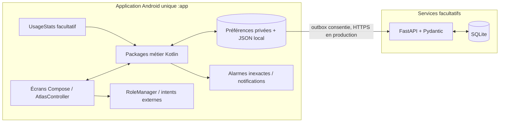

# Architecture effectivement livrée en V4

Ce document décrit la branche `feat/atlas-v4-android17` après les lots A–G, H1, H2 et H3. La cible plus ambitieuse reste décrite dans [02-architecture.md](../../02-architecture.md); les éléments non implémentés y sont désormais signalés.

## Vue réellement construite

## Modules et état

| Zone cible | Réalisation V4 | État |
|---|---|---|
| `android/app` | Une application Gradle `:app`, Kotlin, Compose, `AtlasApp`, navigation et `AtlasController`; composants métier regroupés en packages Kotlin | Livré; pas de découpage en modules `feature-*` |
| `core-domain` | Règles et modèles Kotlin sous `focus`, `habits`, `routines`, `rules`, `usage`, `coach`, `sync` | Plusieurs fonctions pures sont couvertes par JVM; pas de module Gradle `core-domain` séparé |
| `core-data`, Room / DataStore | État privé local migré depuis les maps JSON par `LocalStateStore` / `AndroidStateBackend`; préférences pour options et configuration; outbox durable en fichier privé | Livré avec stockage local; aucune base Room/DataStore côté Android |
| Focus | Sessions paramétrables, transitions calculées localement, persistance/récupération, alarmes `AlarmManager.set` inexactes, notifications optionnelles | Livré; Android peut retarder une frontière d'alarme |
| Habitudes | CRUD, calendrier quotidien/hebdomadaire, check-in/retrait, score/historique, CSV et rappel local facultatif | Livré; rappel inexact, sans promesse d'heure exacte |
| Observation | `UsageStatsManager`, permission d'accès aux données d'utilisation, consentement distinct, allowlist, rétention courte, friction par notification/intention explicite | Livré en option; polling best effort, aucun `AccessibilityService` |
| HOME | Tiroir Compose filtré aux activités `MAIN/LAUNCHER`; demande du rôle `ROLE_HOME` sur action utilisateur; retour vers l'accueil système | Livré en option, rôle jamais pris implicitement |
| Contenus | Liens et recherches saisis manuellement, épingles et suppression; ouverture via `ACTION_VIEW` avec traitement de l'absence d'application | Livré; aucune intégration API YouTube/ReVanced |
| Coach | Proposition locale déterministe; capacités contrôlées par flags; vérification déterministe des actions supportées | Livré en mode local; pas de LLM |
| Backend | FastAPI/Pydantic, SQLite, contrat versionné, authentification Bearer; APK `LocalMock` par défaut, Sync facultative, catégories consenties, outbox avec retries et purge | Livré; nécessite activation et configuration explicites |
| OpenClaw / agent | Interfaces et contrats, provider mock déterministe | Contrats seulement; aucun agent, LLM, outil, shell ou accès Android connecté |

## Source de vérité, stockage et consentement

Android reste source de vérité pour Focus, habitudes, capacités et choix de consentement. Le backend est désactivé par défaut; l'activation de Sync ne suffit pas sans consentement à une ou plusieurs catégories. Les événements minimisent les données : aucun nom de tâche ou d'habitude, titre/URL de contenu ou identifiant de paquet n'est transmis. Le token Bearer est chiffré avec Android Keystore. L'outbox Android est privée et durable; les réponses réseau n'écrasent pas les consentements locaux.

La permission Android `INTERNET` est utilisée par la Sync facultative. Le manifest commun refuse le cleartext; la variante debug autorise seulement `10.0.2.2` pour l'E2E de l'émulateur. Les builds release exigent HTTPS. La cible finale est `targetSdk 36`; l'accès LAN reste implicitement autorisé jusqu'à la cible 36 selon la politique Android 17. Une adoption de 37 exige une déclaration et un consentement runtime `ACCESS_LOCAL_NETWORK`, qui ne sont pas livrés.

## Sécurité et limites d'exécution

Les règles Android sont locales et déterministes. Une routine ou une proposition d'agent ne démarre pas une session sans action humaine. Les événements UsageStats ne déclenchent pas d'interception précise. Les notifications ne lancent pas d'Activity seules; l'écran d'intention s'ouvre après un tap explicite de l'utilisateur. Le dialer, les réglages et les urgences ne sont jamais bloqués.

Les alarmes Android sont inexactes (`AlarmManager.set`); l'application ne demande ni `SCHEDULE_EXACT_ALARM` ni l'accès spécial associé. La permission `POST_NOTIFICATIONS` est demandée uniquement pour les fonctions activées qui en ont besoin. La permission de statistiques d'utilisation est accordée/révoquée dans les réglages Android. La sortie d'urgence et la reprise du launcher système restent disponibles hors ligne.

## Écarts avec la cible initiale

- Les packages métier vivent dans l'unique module `:app`; aucune architecture multi-module `core-*` / `feature-*` n'est livrée.
- Le stockage Android ne comprend ni Room ni DataStore. L'export local disponible est CSV pour les habitudes; il n'existe pas d'export JSON universel.
- Aucun WorkManager, PostgreSQL, migration Alembic, scheduler serveur, fournisseur RSS ou déploiement public n'est livré.
- Le backend est un adaptateur facultatif local/privé, pas une dépendance de l'expérience quotidienne.
- Les actions de proposition acceptées ne sont pas des commandes autonomes; aucune API agent ne reçoit de moyen d'exécuter des actions système.
- `AppControlProvider` reste `UsageStatsManager`; l'accessibilité, Device Owner, root et kiosque sont hors périmètre.

## Références de réalisation

- Architecture cible : [docs/02-architecture.md](../../02-architecture.md).
- Baseline technique et AVD : [00-baseline-android17.md](00-baseline-android17.md).
- Provenances tierces : [01-reemploi-open-source.md](01-reemploi-open-source.md) et [THIRD_PARTY_NOTICES.md](../../THIRD_PARTY_NOTICES.md).
- Contrats OpenClaw futurs : [05-suite-openclaw-future.md](05-suite-openclaw-future.md).
