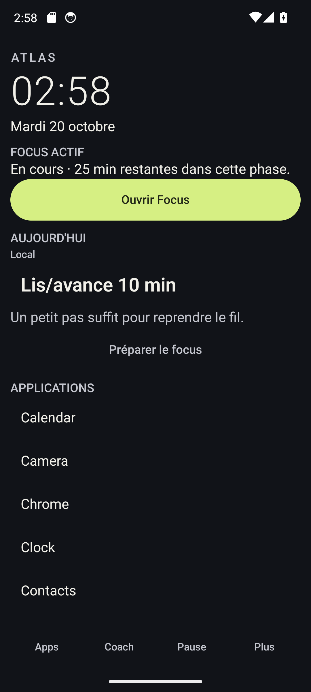
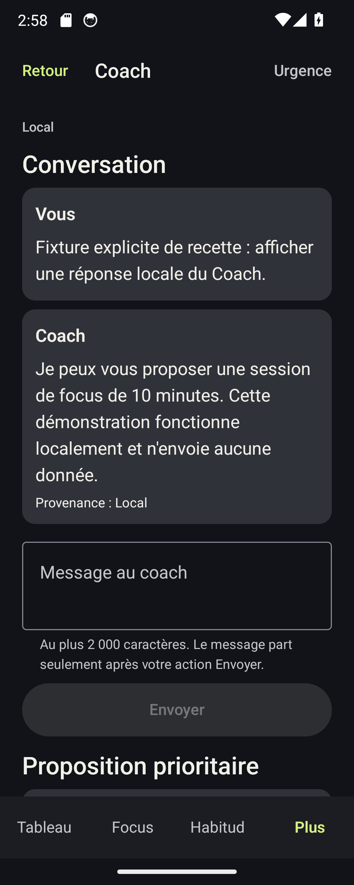

# ATLAS V6.2 — livraison intégrée et preuves

État vérifié le 20 octobre 2026. Base et HEAD : `main`, `ee1e7b58c06531f6fdc631a42cdd7522d8ee90e1`. Les changements restent non commités ; aucun commit, push ou merge n'a été réalisé. Le prompt maître non suivi préexistant a été conservé intact.

## Implémentation livrée

- HOME Compose textuel sans grosses cartes, Focus actif prioritaire, favoris, recherche classée localement et pied Applications/Coach/Pause/Plus. Sortie vers le launcher précédent et réglages HOME accessibles depuis Plus. Les actions secondaires sont neutres ; l'action principale seule est accentuée. Les identifiants de contexte sont masqués dans le parcours Coach, y compris pour les anciens messages persistés.
- `goals/` : modèle local versionné, création/édition, statuts et liens explicites vers Focus/habitudes, progression calculée depuis les accomplissements réels. Confirmation explicite pour les objectifs manuels. Trois objectifs actifs dans le Coach, prochaine action prioritaire sur HOME. Aucune mémoire distante concurrente ni synchronisation implicite des objectifs.
- `sync/agent/context/` : sept catégories Android, dates de consentement migrées au moment de la migration, reconstruction des domaines juste avant l'écriture réseau, aperçu du prochain payload et trace du dernier partage. Limites 10 éléments × 200 caractères et 8 Kio UTF-8 sur l'enveloppe ; fenêtres de 7 jours Focus, 30 jours habitudes, 24 h usage et 15 minutes localisation. Le backend accepte l'union des 13 catégories historiques/Android et minimise selon le consentement.
- `coach/proactive/` : événements locaux fiables regroupés, déduplication/cooldown adaptés d'AndyClaw, au plus 6 plans par jour, 60 minutes par motif, silence 22–08 h, notifications 3 en normal/5 en renforcé. Fuseau du mandat, réservations durables et purge sur révocation. `/v2/agent/plan` reçoit le motif minimal vérifié sans faux message dans la conversation. Le mode renforcé ne change pas `preauthorized`.
- Observation : polling visible conservé, travail unique WorkManager `atlas_usage_observation` toutes les 30 minutes. Même contrôleur et moteur synchronisé, mêmes consentements et stockage. Délais Android possibles ; aucune interception instantanée promise.
- `location/` : acquisition Android coarse par défaut, timeout 10 s, cache 15 s, fallback API 26–29, frontière d'anonymisation OpenClaw de 2 km. Service foreground explicitement lancé depuis une Activity visible, notification Arrêter, durée maximale 60 minutes et espacement minimal de 5 minutes. Aucun accès background, trajet brut, redémarrage silencieux ou reconnaissance d'activité.
- Le vérificateur de mandat, le dispatcher, l'inbox/ACK, l'idempotence et la pause d'urgence restent en place. Les migrations et la récupération locale sont testées ; Focus désactivé reste visible en pause et reprend cet état après recréation. Le snapshot des interventions est rafraîchi après observation.

## Validation finale

| Contrôle | Résultat et preuve |
| --- | --- |
| Relance racine `testDebugUnitTest lintDebug assembleDebug compileDebugAndroidTestKotlin` | Succès ; **256 JVM**, 0 échec/erreur/ignoré. [Gradle](logs/livraison/gradle-root.log) |
| Lint | **0 erreur**, 49 avertissements non bloquants ; aucune `MissingPermission` |
| Backend, venv réel `python -m pytest backend/tests -q` | **66 réussis, 1 ignoré**, avertissement de dépréciation Starlette. [pytest](logs/livraison/pytest-root.log) |
| Suite instrumentée générique, AVD API 34 | **48/48**, 0 échec/erreur/ignoré, 17 classes. [XML](logs/livraison/instrumentation.xml) |
| Reprises avec préconditions hôte | **10/10 exécutions**, dont AppOps refusé, quatre ouvertures de la fixture, paysage et captures. Certaines reprennent des méthodes déjà présentes dans la suite : ne pas les compter comme dix tests uniques supplémentaires. [Comptage](logs/livraison/counts.txt) |
| OpenClaw réel → Android | Deux chats HTTP 200, objectif **25/120**, proposition acceptée, effet HOME journalisé, Goals absent du payload suivant après révocation. **25 minutes simulées par FakeClock**, pas 25 minutes murales. [Gateway](logs/recette-native/gateway-final/v62-gateway-instrumentation.log), [backend](logs/recette-native/gateway-final/v62-gateway-backend.log) |
| Backend arrêté | Focus, objectif, favori et pause d'urgence conservés. [Offline](logs/recette-native/gateway-final/v62-offline-instrumentation.log) |
| Acquisition coarse réelle | Un fix de **5 ms**, précision OS **2 000 m**, puis un timeout réel lors d'un second essai sur le même AVD. Fonctionnement démontré une fois, fiabilité AVD intermittente. [Recette](RECETTE_COMPLETE.md) |
| Mobilité | Démarrage visible, notification Arrêter et arrêt/révocation testés ; collecte de déplacement mesuré non validée de manière reproductible faute de fix fiable. Le test ne crée pas de mesure fictive. |
| Revue visuelle | **21 captures finales**, 320/360 dp, sombre/AMOLED, favoris, Focus, tiroir, police 1,5×/2× et paysage. Contraste palette ≥4,5:1 contrôlé par instrumentation. Captures HOME et Coach relues par l'orchestrateur. [Manifeste](logs/livraison/capture-validation.txt) |
| Secrets et diff | Recherche des secrets Gateway configurés : aucun dans les 2 192 fichiers examinés avant cette synthèse ; aucun secret affiché. [Scan](logs/livraison/secret-scan.json). `git diff --check` passe. |

Les tests filtrés pour préconditions hôte ne sont pas présentés comme exécutés par le run générique. AppOps/fixture/paysage sont ensuite exercés avec leur harnais ; Gateway possède sa preuve dédiée. Les tests d'injection coarse gardent leurs résultats séparés. Les suites JVM ciblées et les fixtures déterministes ne remplacent pas une intégration réelle.

## Revue et corrections

La [revue indépendante](REVUE_INDEPENDANTE.md) est un relevé historique avant corrections. Ses constats sur fraîcheur des domaines, double coarsening, budget, statut des objectifs, fuseau et triggers de plan ont été traités. Les objectifs inactifs sont omis du contexte ; les résumés de localisation déjà coarsened ne sont plus retraités. Les notices de réemploi sont actualisées. La dernière recette a également corrigé les trois régressions produit trouvées par l'instrumentation : [preuves et explications](CORRECTIONS_PRODUIT_FINALES.md).

Les captures anciennes d'un Coach réel peuvent montrer des empreintes de contexte : elles précèdent la correction visuelle. La capture finale Coach utilise une **fixture locale explicitement indiquée** ; elle n'est pas une nouvelle réponse OpenClaw.





## Limites explicites

- Android 17 : les premiers AVD jetables API 37.2 ont planté dans SurfaceFlinger/RegionSampling (`hasReadColorBufferDma`) avant la recette ATLAS. Cela ne permet pas d'affirmer la compatibilité V6.2 Android 17. Une ultime vérification isolée est consignée dans [le rapport Android 17](RAPPORT_ANDROID17.md).
- Localisation approximative : disponibilité et fraîcheur restent soumises au fournisseur Android. Un timeout ne produit ni conclusion de mobilité ni point fictif. Aucun trajet mesuré reproductible, géofence permanente ou mode Always n'est revendiqué.
- TalkBack : activation temporaire et navigation clavier contrôlées, puis restauration ; annonces vocales non enregistrées, audit partiel. Aucun test sur Pixel physique.
- Pas de mesure quantitative de batterie, coût réseau au repos ou benchmark multi-appareils ; les quotas et planifications sont testés, pas leur consommation matérielle. Pas de publication ni de CI distante relancée sur des changements non poussés.
- Une occurrence d'échec d'écriture locale a été signalée par classe d'exception dans la recette ; elle conserve le message d'erreur utilisateur. Aucun test final ne l'a reproduite comme régression. Voir le rapport de corrections pour les circonstances.

La recette Android 14 est passante avec les préconditions détaillées ; les réserves ci-dessus empêchent une affirmation de validation universelle. Le backend reste facultatif. Aucune donnée ou AVD personnel n'a été effacé.

## Reproduire et utiliser

```sh
cd android
./gradlew testDebugUnitTest lintDebug assembleDebug compileDebugAndroidTestKotlin
cd ..
backend/.venv/bin/python -m pytest backend/tests -q
```

Le [script instrumenté](../../scripts/v62-complete-instrumentation.sh) vérifie un AVD jetable précis et efface uniquement les données de ses packages de test : ne pas l'utiliser sur un téléphone personnel. Le [guide Pixel](GUIDE_PIXEL.md) décrit l'installation et la recette non destructive sur téléphone secondaire. Le [guide OpenClaw existant](../v6/GUIDE_UTILISATEUR.md) reste applicable ; le jeton Gateway appartient au backend. [Contrats](CONTRATS_INTERFACES.md), [mandat et matrice d'actions](../v6/SECURITE_ET_MANDAT.md), [réemploi OSS](REEMPLOI_OSS.md).
