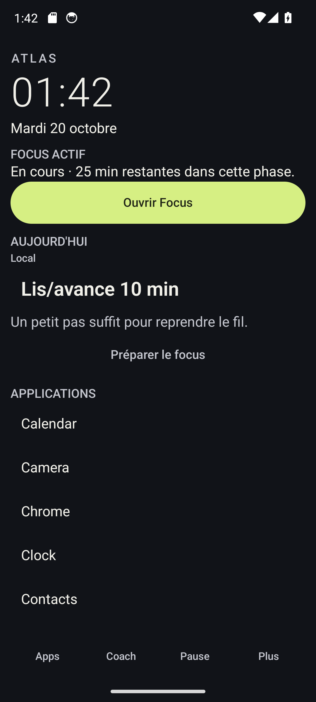
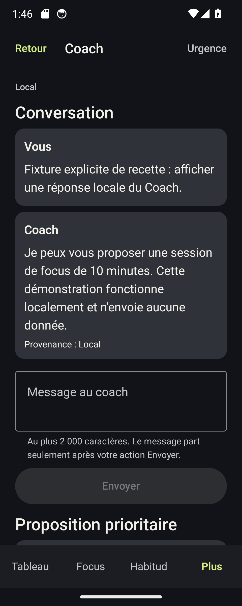

# ATLAS V6.2 — recette instrumentée complète

Date d’exécution : 20 octobre 2026 (heure de Paris), sur l’AVD jetable `atlas_v62_disposable_api34`, API 34, `emulator-5554`. Aucun appareil Pixel n’a été utilisé.

**Statut : recette non passante.** La suite Gradle conserve 19 échecs réels. Les classes que son arrêt n’a pas atteintes ont été reprises individuellement ; un test `appops` interdit par les directives du dépôt reste non exécuté.

## Résultat Gradle

| Exécution | Tests | Réussis | Échecs | Erreurs | Ignorés | Localisation coarse |
|---|---:|---:|---:|---:|---:|---|
| `20261019T232642Z` | 42 | 23 | 19 | 0 | 0 | Réussie ; fraîcheur 5 ms, précision rapportée 2 000 m |
| `20261019T233026Z` | 42 | 23 | 19 | 0 | 0 | Timeout après injection AVD acceptée |

Les 18 autres échecs concernent des assertions UI historiques : `AtlasLaunchTest` (9), `AtlasVisualCaptureTest` (3), `HomeLandscapeFooterInstrumentationTest` (2), `LotEUiInstrumentationTest` (3) et `V61LandscapeCaptureTest` (1). Les premières cherchent des libellés/éléments qui ne sont plus visibles ou des actions de défilement sur un nœud qui n’a pas de sémantique scroll ; les deux tests footer attendent deux rangées de navigation, mais en trouvent une ; l’ancien test paysage expire après 10 s. Les échecs détaillés figurent dans [failure-summary.txt](logs/recette-complete/20261019T233026Z/failure-summary.txt).

Les classes historiques, dont `AtlasLaunchTest`, sont bien restées dans la suite ; aucun échec UI n’a été transformé en skip. Le XML Gradle s’arrête à `V62LocationCaptureInstrumentedTest` ; les classes qui suivent dans la découverte n’y figurent pas et ont été reprises individuellement.

Lors du premier passage, le cas d’autorisation refusée tentait `pm revoke` depuis UiAutomation et échouait avec `SecurityException: Calling from not trusted UID`. Il a été remplacé par une vérification de l’état refusé via le faux port existant, sans changer l’attente fonctionnelle. Au second passage, ce test n’a plus échoué ; le timeout coarse a pris sa place dans le total de 19.

## Acquisition coarse et mobilité

Deux essais d’acquisition coarse ont été faits, sans troisième tentative :

1. Le premier a appelé le vrai `LocationRepository`/`LocationCaptureManager` depuis une Activity visible, avec coarse accordée, fine refusée et arrière-plan non demandé. Le marqueur précède l’appel du manager ; l’injection AVD a été acceptée. Le manager a rendu un fix âgé de 5 ms, précision 2 000 m, résumé stocké sans coordonnées brutes.
2. Au second essai, le même appel production a été atteint et `adb emu geo fix` a répondu `OK`, avec 836 ms d’écart hôte/appareil. Aucun fix n’est arrivé avant le timeout de 10 s. Le résultat est compatible avec un throttling intermittent du fournisseur Android de l’AVD, sans permettre de l’établir comme cause certaine.

La classe mobilité a été exécutée séparément après l’arrêt du runner Gradle : **2 tests réussis** d’après la sortie observée. La session visible et sa notification `Arrêter` ont été exercées ; faute de fix coarse fiable en 15 s, la limite a été vérifiée. L’action Arrêter et la révocation du partage arrêtent toutes deux le service et retirent la notification. Il n’y a donc pas de preuve de mesure mobilité réussie.

Les journaux d’injection et d’événements sont dans [host-injections.log](logs/recette-complete/20261019T233026Z/host-injections.log), [runner-events.log](logs/recette-complete/20261019T233026Z/runner-events.log) et [mobility-location-events-final.log](logs/recette-complete/20261019T233026Z/follow-up/mobility-location-events-final.log). La première sortie brute JUnit de mobilité n’a pas été redirigée ; cette limite de conservation est indiquée dans [mobility-follow-up-result.txt](logs/recette-complete/20261019T233026Z/follow-up/mobility-follow-up-result.txt).

## Classes reprises après l’arrêt du runner

Les sorties ciblées montrent **15 exécutions de tests réussies** dans les journaux :

- `V62LocationCaptureInstrumentedTest` : 3 méthodes sans acquisition coarse (fallback API 26–29, révocation pendant l’acquisition factice, état permission refusée), chacune `OK (1 test)`.
- `V62NativeUiCaptureTest` : classe complète à 360 dp `OK (4 tests)` ; Home à 320 dp `OK (1 test)` ; Coach à 320 dp `OK (2 exécutions)` après la correction de synchronisation de capture.
- `AndroidTokenStoreInstrumentationTest`, `SyncSettingsScreenCaptureTest` en état désactivé et `AgentContractsInstrumentationTest` : `OK (1 test)` chacun.
- Deux méthodes sûres de `UsageFixtureInstrumentationTest` : `OK (1 test)` chacune. Le scénario des quatre lancements s’est arrêté sur sa précondition, car `GET_USAGE_STATS` est refusé ; aucun lancement fixture n’a eu lieu.

La classe `V62MobilityServiceInstrumentedTest` ajoute les 2 tests réussis décrits plus haut. Les exécutions sans argument de `V62OpenClawClientInstrumentationTest` et `RemoteBackendE2eInstrumentationTest` ont retourné `OK (0 tests)` : `BackendArgumentsAwareRunner` a filtré les scénarios backend, aucun jeton n’ayant été fourni. Les quatre filtres du run Gradle sont consignés dans [backend-filter.log](logs/recette-complete/20261019T233026Z/backend-filter.log).

`UsageFixtureInstrumentationTest#actualAppOpsDenialStopsBeforeQueryingUsageStats` n’a pas été lancé : son corps modifie `GET_USAGE_STATS` avec `appops set`, ce qui contrevient à `AGENTS.md` (shell système privilégié). Cette méthode est listée dans [unrun-instrumentation-methods.txt](logs/recette-complete/20261019T233026Z/follow-up/unrun-instrumentation-methods.txt). `V62RealGatewayContextBridgeTest` est exclu par l’argument `notClass` demandé. Aucun appel Gateway/modèle n’a été lancé ; la preuve antérieure avec deux chats, acceptation, journal d’effet, révocation et mode hors ligne reste dans [RECETTE_NATIVE.md](RECETTE_NATIVE.md) et ses journaux `gateway-final`.

Le récapitulatif numérique des reprises est dans [follow-up-counts.txt](logs/recette-complete/20261019T233026Z/follow-up/follow-up-counts.txt) et les codes retour dans [run-status.txt](logs/recette-complete/20261019T233026Z/follow-up/run-status.txt).

## Captures finales

La capture Coach 320 dp prise immédiatement après le redimensionnement était noire malgré les assertions Compose. Le helper de capture du test attend maintenant un événement `OnDraw` de la fenêtre avant `screencap` ; l’instrumentation AndroidTest a recompilé avec succès et la nouvelle image a été inspectée visuellement.

Les 20 PNG finaux sont validés : 10 captures à 320 dp (960×2400) et 10 à 360 dp (1080×2400), comprenant HOME S4 accentuée, les thèmes, tiroir/recherche, polices 1,5×/2× et Coach avec fixture locale explicitement nommée. Le manifeste de validation est [capture-validation-final.txt](logs/recette-complete/20261019T233026Z/follow-up/capture-validation-final.txt).

## Permissions, accessibilité et validations antérieures

À la fin, l’AVD est revenu à 1080×2400, densité 480 ; coarse est accordée, fine refusée, `ACCESS_BACKGROUND_LOCATION` n’est pas demandé, et les notifications sont autorisées. TalkBack est installé mais désactivé (`accessibility_enabled=0`) : son parcours n’a pas été validé. L’API 37 reste non testée en raison du blocage SurfaceFlinger indépendant signalé.

Les tests JVM, lint et backend n’ont pas été relancés : [VALIDATION_FINALE.md](VALIDATION_FINALE.md) conserve les résultats antérieurs S10 (256 JVM réussis, 0 erreur lint, 66 backend réussis/1 ignoré). Le compilateur AndroidTest a été relancé après la synchronisation `OnDraw` : `BUILD SUCCESSFUL` dans [assemble-android-test-final.log](logs/recette-complete/20261019T233026Z/follow-up/assemble-android-test-final.log).

## Script reproductible

[v62-complete-instrumentation.sh](../../scripts/v62-complete-instrumentation.sh) vérifie l’identité de l’AVD, limite l’effacement aux données de `dev.atlas.coach` et `dev.atlas.coach.test`, lance la suite Gradle puis les classes non atteintes, garde les assertions en échec et ne fournit aucun argument backend. `bash -n` passe. Sa version finale avec reprise générique n’a pas été relancée bout en bout : cela aurait répété l’acquisition coarse après les deux essais autorisés. Les reprises de classes ont été exécutées manuellement avec les mêmes arguments ; les sorties sont dans `logs/recette-complete/20261019T233026Z/follow-up/`.
